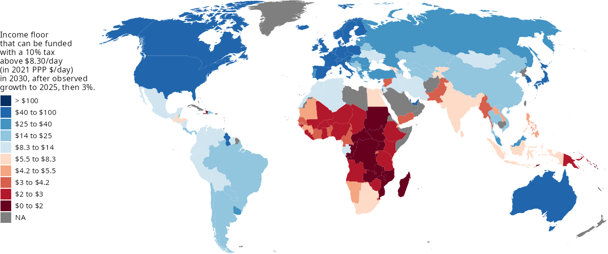
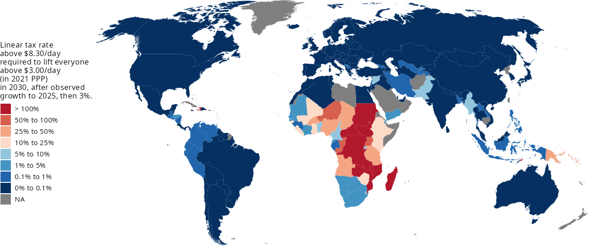

# Four years to 2030: The poorest countries cannot end extreme poverty on their own

*Adrien Fabre (CNRS, CIRED)*

**Teaser.** With four years left to meet the first Sustainable Development Goal, new World Bank data confirm that neither growth nor domestic redistribution can eradicate extreme poverty by 2030 in the poorest countries. Globally, however, the cost of closing the poverty gap would amount to only a fraction of a percent of world income.

---

The very first Sustainable Development Goal (SDG) commits the world to "eradicate extreme poverty for all people everywhere" by 2030. According to the latest World Bank update, released in September 2026, 824 million people, about one in ten humans, still lived below the international poverty line of $3.00 a day in 2024, and extreme poverty is projected to decline only marginally, to 9.8% in 2026 (Castaneda Aguilar et al. 2026). The goal will be missed. But the question of *who* lacks the means to end extreme poverty matters as much for policy as the global headcount.

In a recent paper (Fabre 2025), I asked whether countries could eradicate extreme poverty by 2030 using their own resources, through growth and domestic redistribution. The question has a long history. Ravallion (2010) showed that in the poorest countries, even confiscatory taxes on the "rich" (by US standards) could not close the poverty gap, while Ceriani and Verme (2014) and Bolch et al. (2022) measured the domestic capacity to end poverty with similar thought experiments, the latter finding that 62 countries lacked the resources to eradicate severe poverty. My paper projects these computations to 2030, the SDG deadline. I have now updated the analysis with the September 2026 data of the World Bank's Poverty and Inequality Platform (PIP), which expresses incomes in 2021 purchasing power parities (PPPs) rather than 2017 PPPs, and includes more recent surveys for 118 of the 168 countries covered, including the poorest ones. The answer is unchanged: the poorest countries cannot do it on their own.

## Growth alone will not be enough

I project each country's consumption distribution using the growth actually observed up to 2025, and then to 2030 under various growth scenarios, keeping national inequality constant. With 3% annual growth in every country from 2025, 7.6% of the world population would still live below $3.00 a day in 2030. Even a growth rate of 7% per year, which few countries have ever sustained, would leave 5.2% of humanity in extreme poverty.

## Even radical redistribution falls short in the poorest countries

To gauge the domestic capacity to end poverty, I run idealized thought experiments. Suppose a government taxes consumption above a threshold and transfers all the revenue to the poorest, abstracting from any administrative cost, targeting error, or behavioral response. Take the threshold at $8.30 a day, the World Bank's poverty line for upper-middle-income countries. A 10% tax on consumption above this threshold would fail to finance an income floor at $3.00 a day in 30 countries, including 18 of the 28 low-income countries (Figure 1). Even with 7% annual growth from 2025, this tax would fall short in 20 countries.

What tax rate would then be needed to lift everyone above the poverty line? The required rate averages 101% in Sub-Saharan Africa. In eleven countries, mostly in Sub-Saharan Africa, it would exceed 100% (Figure 2): even confiscating every dollar consumed above $8.30 a day would not suffice to lift the poor above $3.00 a day. In the D.R. Congo, Malawi, and Mozambique, average consumption would remain below $3.00 a day in 2030, so that not even a perfectly equal distribution of resources could end extreme poverty.

**Figure 1.** Income floor that a 10% tax on consumption above $8.30 a day could finance in 2030 (in 2021 PPP$ a day), assuming observed growth to 2025 and 3% annual growth thereafter

*Note: Where the floor is below $3.00 a day (two darkest shades), the tax cannot eradicate extreme poverty. Grey: no data. Source: Fabre (2025), updated with World Bank PIP data (September 2026, 2021 PPP). Interactive maps and country data: [website link].*

**Figure 2.** Linear tax rate on consumption above $8.30 a day needed to lift everyone above $3.00 a day in 2030, assuming observed growth to 2025 and 3% annual growth thereafter

*Note: A rate above 100% means that even capping consumption at $8.30 a day would not raise enough revenue. Grey: no data. Source: Fabre (2025), updated with World Bank PIP data (September 2026, 2021 PPP).*

## What the new data change, and what they don't

Comparisons with the original estimates require care. The new international poverty line of $3.00 is not a mere price conversion of the former $2.15 line: adjusted for prices only, $2.15 would be worth about $2.46 in 2021 prices. Most of the increase reflects higher national poverty lines in low-income countries, set after surveys started capturing more consumption (Foster et al. 2025). The $3.00 line is therefore a more demanding standard.

At the price-equivalent line of $2.46, the results are similar to the original ones, despite most surveys having been replaced. The extreme poverty rate projected for 2030 with 3% growth is 5.2%, as in the original paper, and the average tax rate needed in Sub-Saharan Africa is 55% (vs. 46%). Eight countries (instead of five) could not eradicate extreme poverty even by capping incomes. At the new $3.00 line, the shortfall of domestic resources is more severe and even more concentrated in Sub-Saharan Africa.

One major exception is India. Its new consumption surveys (2022–23 and 2023–24) record much lower extreme poverty than earlier data, so that India now appears able to end extreme poverty with modest domestic redistribution. The World Bank cautions that part of the measured decline may reflect improvements in survey implementation, but even with large margins of error, India no longer looks like a borderline case.

## Five more years would not be enough everywhere

Since the 2030 deadline will be missed, it is worth asking whether a later horizon would change the picture. Extending each growth scenario to 2035, extreme poverty at $3.00 a day would still affect 6.2% of the world population with 3% growth. Five more years of growth would substantially expand domestic resources, but eight low-income countries would still be unable to end extreme poverty even by capping incomes at $8.30 a day, and a 10% tax above that threshold would fall short in 23 countries. Only a decade of 7% annual growth from 2025, a pace far above what these countries have achieved in recent decades, would change the picture: by 2035, every country could in principle end extreme poverty by capping incomes at $8.30 a day. Even then, 2.9% of the world population would remain below $3.00 a day without redistribution, and a 10% tax would still fall short in eight countries.

## The global cost is small

The contrast between national and global capacities is stark. Closing the global extreme poverty gap in 2030 would require transferring 0.31% of world income to the extreme poor (0.17% at the price-equivalent line). In absolute terms, this amounts to about $112 billion a year in 2025 US dollars at market exchange rates, $90 billion of which in Sub-Saharan Africa. This could be financed by a 2.7% tax on the share of individual consumption above $100 a day, a threshold exceeded by less than 5% of the world population. Since the shortfall is concentrated in a few low-income countries, the transfer would essentially flow from high-income to low-income countries.

These figures should be read as orders of magnitude, not policy designs. The policies are idealized: they ignore administrative costs and tax distortions, and household surveys poorly capture top incomes, which leads to understate domestic resources in some countries (although rescaling surveys to national accounts does not change the picture for the poorest countries). Conversely, cash transfers are only one way to reduce poverty, and other dimensions, like health and education, also matter.

## Policy implications

Three implications follow. First, in low-income countries, ending extreme poverty quickly is not a matter of domestic policy effort: their resources are simply insufficient, even under extreme assumptions. Calls for "domestic resource mobilization" are relevant for middle-income countries, including India, but cannot substitute for international support in the poorest countries. Second, the relevant international effort is small relative to global income, but not relative to aid. The extreme poverty gap (about $112 billion a year) represents 64% of all official development assistance in 2025 ($174 billion, after a record 23% fall), and the gap in Sub-Saharan Africa ($90 billion) is three times the bilateral aid the region received ($29 billion; OECD 2026). As the poverty gap assumes perfect targeting, it is a lower bound on the actual cost of ending extreme poverty. Third, as the world approaches the 2030 deadline, the post-2030 agenda should acknowledge that eradicating extreme poverty is a question of international solidarity, for instance through global taxes on the very top of the distribution, as recently discussed at the G20.

## References

Bolch, K. B., L. Ceriani and L. F. López-Calva (2022), "The Arithmetics and Politics of Domestic Resource Mobilization for Poverty Eradication", *World Development* 149: 105691.

Castaneda Aguilar, R. A., et al. (2026), "September 2026 Update to the Poverty and Inequality Platform (PIP): What's New", Global Poverty Monitoring Technical Note 53, World Bank.

Ceriani, L. and P. Verme (2014), "The Income Lever and the Allocation of Aid", *Journal of Development Studies* 50(11): 1510–1522.

Fabre, A. (2025), "Shortfall of Domestic Resources to Eradicate Extreme Poverty by 2030", *Journal of Development Studies*, https://doi.org/10.1080/00220388.2025.2493807.

Foster, E., D. Jolliffe, G. Lara Ibarra, C. Lakner and S. Tetteh-Baah (2025), "Global Poverty Revisited Using 2021 PPPs and New Data on Consumption", Policy Research Working Paper 11137, World Bank.

OECD (2026), "A Historic Decline in Foreign Aid: Preliminary 2025 ODA Data", April 2026.

Ravallion, M. (2010), "Do Poorer Countries Have Less Capacity for Redistribution?", *Journal of Globalization and Development* 1(2).

*Code and data: github.com/bixiou/domestic_poverty_eradication (technical note: paper/update.pdf).*
